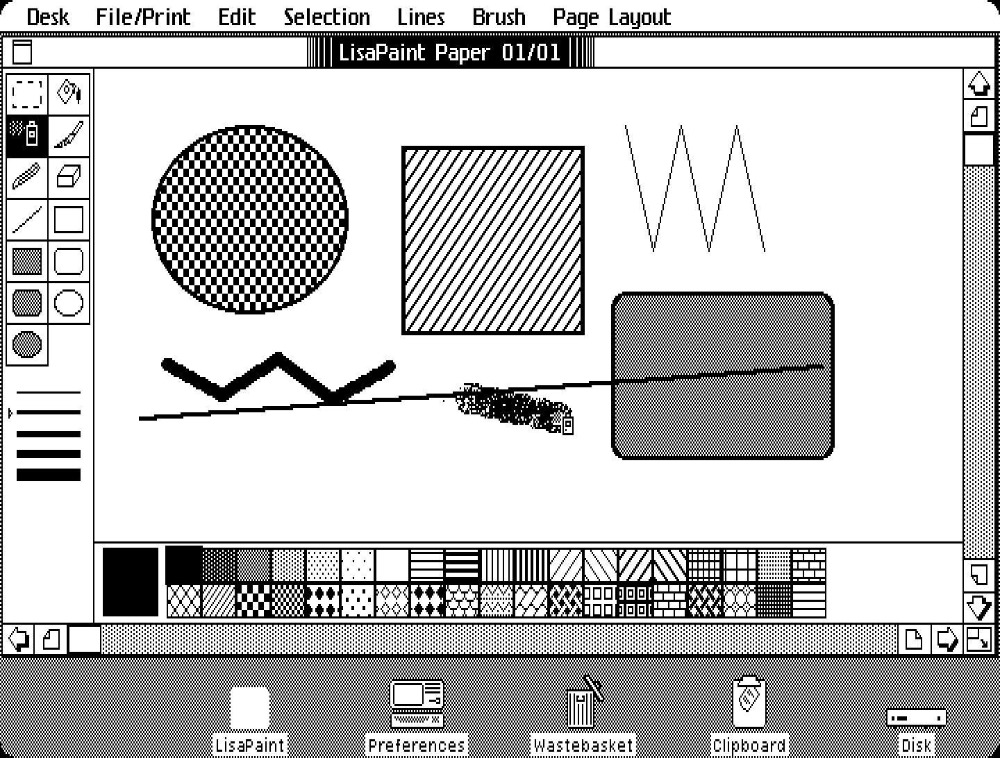
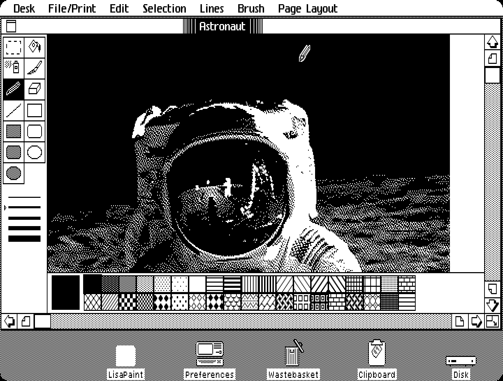

# LisaPaint

A pixel painting tool for the Apple Lisa Office System (LOS 3.x), in the
spirit of MacPaint but built the Lisa way. It's written in C and cross-compiled
with [lisa-c](https://github.com/pappadf/lisa-c); it runs on the LOS desktop
(tested in the granny-smith emulator).



*LisaPaint in the granny-smith emulator, at the Lisa screen's true aspect
ratio: the 720 x 364 screen with each pixel shown 2 wide and 3 tall, because
Lisa pixels are about 1.5 times taller than wide.*



*The demo picture that comes on the floppy: a 576 x 720 MacPaint-size
picture at the top left of LisaPaint's 720 x 800 page.*

**Try it in your browser:** [pappadf.github.io/lisa-paint](https://pappadf.github.io/lisa-paint/)
boots a Lisa in the granny-smith emulator with the latest release's floppy in the drive.

## Quick start

On Linux (x86_64 or arm64) with git, make, Python 3, curl, unzip, meson and
ninja:

```bash
git clone --recursive https://github.com/pappadf/lisa-paint
cd lisa-paint
make toolchain    # once: download lisa-c's prebuilt compiler
make serve        # build, then print a link to open in your browser
```

The link opens granny-smith (the emulator's web build) with the Office System
3.1 started and the LisaPaint floppy in the drive. The Lisa ROM and the Office
System disk are loaded from copies on archive.org unless you have your own (see
below). On the Lisa desktop, open the **LisaPaint** diskette, then open the
**Astronaut** picture, or double-click the **LisaPaint Paper** pad to tear off
a new sheet and open that.

The first `make` also builds picolibc for the 68000, which takes a minute or
two.

## What it does

- **Tools** (palette on the left): selection, paint bucket, spray can, brush,
  pencil, eraser, line, and rectangle, rounded rectangle and oval, each hollow
  or filled.
- **38 patterns** (palette under the picture), **5 line widths** (palette, or
  the Lines menu), **7 brush shapes** (Brush menu).
- **Selection**: drag a rectangle (marching ants), drag it to move it, Cut /
  Copy / Paste / Clear, Select All of Document; Invert, Fill with Pattern,
  Flip Horizontal, Flip Vertical.
- **Undo Last Change**: one level. Choosing Undo again redoes the change.
- **Magnify Pixels** / **Show Actual Size** (Page Layout menu): a 4x view in
  which every tool works.
- **Shift** constrains lines to 0, 45 and 90 degrees, and rectangles and ovals
  to squares and circles, *as they look on the Lisa screen* (see below).
- **Scroll bars and size control**: the Office System's own, shown only while
  the window is active (arrows, page-at-a-time gray areas, draggable
  elevator). There is no "hand" tool; use the scroll bars.
- **Documents**: the picture is 720 x 800 pixels: as wide as the Lisa screen
  (8 inches; a little wider than the window shows, so it scrolls both ways)
  and 13.3 inches tall. A MacPaint page (576 x 720) is its top left corner,
  pixel for pixel (see [MacPaint and PNG](#macpaint-and-png)).

## Lisa conventions it follows

- It's document-centric. The user tears a sheet off the "LisaPaint Paper" pad
  and opens it, and the Desktop Manager starts LisaPaint. There is no New,
  Open, Save As, Close or Quit.
- **File/Print**: Set Aside Everything, Set Aside "*document*", Save & Put
  Away, Save & Continue, Revert to Previous Version, and the printing items
  (dimmed: printing is not implemented).
- **Edit**: Undo Last Change, Cut (Apple-X), Copy (Apple-C), Paste (Apple-V),
  Clear, Select All of Document (Apple-A).
- Unavailable commands are dimmed. Show Actual Size and Magnify Pixels are a
  pair, with the one in effect dimmed.
- Alerts live in the phrase file, as full sentences. Revert to Previous Version
  asks first, in a Caution alert: "... Once you click OK, you will not be able
  to change your mind, even with Undo."
- **Non-square pixels.** Lisa pixels are about 1.5 times taller than wide (90 x
  60 dots per inch). The palette cells (30 x 20), the round brushes, the eraser
  (16 x 11), the cursors and the Shift constraints are all drawn for that: a
  circle is 3 pixels wide for every 2 tall. Magnify Pixels scales both
  directions by 4, so the picture keeps its proportions.

## Documents on disk

The Desktop Manager gives each document a diskfile prefix (for example
`-#13-{D103T21}`). LisaPaint keeps two files:

- `<prefix>PIC`: the picture as last saved. Save & Continue, Save & Put Away
  and closing write it, and Revert to Previous Version reads it back.
- `<prefix>SUS`: the working state when the document is suspended (the
  Desktop Manager's fcSuspend). It's read first when the document is opened.

Each file is LisaPaint's own format: a 52-byte header followed by the
picture's 72,000 bytes. All numbers are big-endian 16-bit integers.

| Offset | Field |
|---|---|
| 0 | `"LPNT"`, version 2 |
| 6 | width, height, rowBytes: 720, 800, 90 |
| 12 | view position (sx, sy), zoom (1 or 4) |
| 18 | tool, pattern, line width, brush |
| 26 | selection: a flag, then its rectangle (top, left, bottom, right) |
| 36 | 8 spare words, 0 |

The picture is 800 rows of 90 bytes, 1 bit per pixel, 1 = black, high bit
leftmost, not compressed. On LOS 3.1,
Set Aside only hides the window: LisaPaint keeps the picture in memory until the
document is put away.

## MacPaint and PNG

`tools/lpconv.py` converts pictures between LisaPaint (`.lpnt`), MacPaint
(`.mac`, `.pntg`, `.macpaint`) and PNG (`.png`), choosing the format by file
extension:

```bash
tools/lpconv.py old.mac old.png             # or any other pair
make PICTURES="demo/astronaut.png old.mac"  # put pictures on the floppy as documents
make export FLOPPY=saved.dc42               # pictures on a floppy -> build/export/*.png
make export FLOPPY=saved.dc42 FORMAT=mac    # ... as MacPaint files
```

- Pixels are copied one to one, never rescaled. A MacPaint picture (always
  576 x 720) goes in the top left corner of the 720 x 800 page, with white
  to the right and below; exporting to MacPaint keeps that corner, and warns
  if anything outside it is left out. PNG and LisaPaint files hold the whole
  page. A Lisa pixel is taller than a Mac's, so a picture looks taller on the
  Lisa and squatter on a Mac or in a plain PNG.
  `tools/lpconv.py --aspect in out.png` writes a PNG at the Lisa screen's
  proportions instead (each pixel 2 wide and 3 tall).
- PNG pictures are turned black and white (anything darker than 50% gray is
  black). Prepare photos with a dither, as `demo/astronaut.png` is. A PNG can
  be up to 720 x 800; a smaller one goes at the top left of the page.
- **Import:** each file in `PICTURES` becomes a document on the floppy, named
  after the file (`astronaut.png` -> "Astronaut"). The default is
  `demo/astronaut.png`.
- **Export:** reads a floppy image that the Lisa has written. You can save one
  from granny-smith, for example with `SAVE=` in
  `lisa-c/emu/run-los-tool.sh`. Each LisaPaint document is exported under its
  desktop name: the picture as last saved, or failing that its set-aside state.

The demo picture is Buzz Aldrin on the Moon, from NASA's Apollo 11 photograph
AS11-40-5903 (public domain), dithered at MacPaint's 576 x 720 for the Lisa's
pixel shape.

## Building and running

lisa-c comes in as a git submodule (`lisa-c/`, pinned to the version
LisaPaint is tested with):

```bash
git clone --recursive https://github.com/pappadf/lisa-paint
cd lisa-paint
make toolchain    # once: lisa-c's prebuilt compiler (Linux x86_64 or arm64)
make
```

`make` writes `build/lisapaint.dc42`: a floppy with `{T21}obj` and
`{T21}PHRASE`.

If you already have a lisa-c clone next to this directory and no submodule,
that's used instead (or set `LISA_C=/path/to/lisa-c`).

```bash
make serve        # run it yourself: granny-smith in your browser, LOS 3.1 booted with the
                  # LisaPaint floppy in the drive (prints the address to open)
make run          # install it on the LOS desktop and open it (build/emu/*.png)
make demo         # paint with every tool, magnify, put away, reopen, revert
                  # (build/demo/*.png)
```

`make serve` downloads granny-smith's web build from its GitHub releases (once)
and serves everything from a local web server; in a GitHub Codespace it prints
the forwarded address too. It uses your own Lisa ROM and Office System disk when
you have them (`LISA_ROM`, a Lisa 2 boot ROM, rev H, and `LOS_IMAGE`, Office
System 3.1 on a ProFile, or the same files in `lisa-c/media/`), and otherwise the
archive.org copies. `make run` and `make demo` are scripted runs in
granny-smith's headless emulator: they need `GS_HEADLESS` and your own files.
See `lisa-c/emu/env.sh`.

lisa-c compiles every `.c` file in `src/` and `lisapaint.phrase`, and writes the
floppy (`make -C lisa-c PROG=lisapaint SRCDIR=$PWD/src TOOLNUM=21
TOOLNAME=LisaPaint tool`). The floppy carries the Desktop Manager's catalog,
which registers the tool and its stationery pad, so the Office System uses it
as it is (no Repair). On a real Lisa, copy the image to a 400K diskette.

To move to a newer lisa-c: `git -C lisa-c pull`, check that everything still
works, then commit the new `lisa-c` pointer.

## Releases

Pushing a version tag (`git tag v0.1 && git push origin v0.1`) runs
`.github/workflows/release.yml`. It builds the floppy, attaches it to the
GitHub release as `lisapaint-<tag>.dc42`, and publishes it on GitHub Pages:

- `https://pappadf.github.io/lisa-paint/lisapaint.dc42` is the latest floppy.
  Pages sends CORS headers, so granny-smith's web build can load it with
  `FD0=<that URL>`, as the [Boot Shelf](https://github.com/pappadf/gs-docs)
  entry does.
- `https://pappadf.github.io/lisa-paint/` is a page with a Boot link
  (`tools/pages.py`).

The first time, set the repository's Settings > Pages > Source to "GitHub
Actions". Then, under Settings > Environments > github-pages, add `v*` to the
deployment branches and tags: by default only `main` may deploy, and this
workflow runs on tags.

## Source

| File | What |
|---|---|
| `src/main.c` | Startup, event loop, menus, the Desktop Manager (Filer) protocol |
| `src/view.c` | Window layout, palettes, scroll bars, size control, copying the picture to the screen |
| `src/tools.c` | The tools, the selection, Undo, the clipboard |
| `src/doc.c` | Reading and writing the document's diskfiles |
| `src/art.c` | Patterns, tool icons, cursors |
| `src/lisapaint.phrase` | Menus and alerts |
| `tools/lpconv.py` | Converting pictures to and from MacPaint and PNG; export from floppy images |
| `demo/astronaut.png` | The demo picture put on the floppy |
| `tests/demo.sh` | Scripted session in granny-smith |
| `tools/pages.py`, `.github/workflows/release.yml` | Releases and the GitHub Pages site |

## Not yet

- **The Lisa Clipboard.** Cut, Copy and Paste use LisaPaint's own clipboard
  (shared between pictures, but not with other tools).
- **Printing.**
- **A text tool.**
- **Custom icons** for the tool, pad and document (they use the generic ones).
- **Several pictures at once.** LisaPaint declines a second picture while one is open (it tells the Desktop Manager `noMoreDocs`).

## A Note on AI

This project allows the use of AI. That isn't limited to code generation or
code review: it also covers documentation and research into how the Lisa
Office System works.
There is no intention to track, at the file or commit level, which code was
written with AI assistance and which wasn't. I know that AI may be a red flag
for some people, and I fully respect that.

## Trademarks

All trademarks referenced in this project are the property of their respective owners and are used for identification purposes only. This project does not claim any endorsement by or affiliation with the trademark holders.

## License

MIT; see `LICENSE`.
